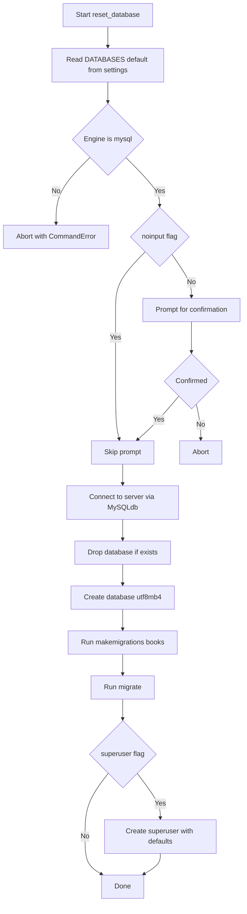

# Plan: `reset_database` command + stop tracking migrations

> **Implementation status:** `reset_database` exists, but this design document does not describe its current migration behavior exactly. The implemented command drops/recreates the configured MySQL/MariaDB database, optionally backs it up, deletes every `books/migrations/*.py` file except `__init__.py`, regenerates migrations with `makemigrations`, and applies them. Numbered migration files remain tracked in Git; the planned `.gitignore` and untracking changes were not applied. Treat the sections below as the original plan, not as confirmation that all acceptance criteria are met.

## Goal

Provide a safe, repeatable way to rebuild the MySQL/MariaDB schema from scratch, and
stop version-controlling generated migration files so each environment regenerates
them from `books/models.py` as the single source of truth.

## Decisions

- **Superuser credentials** — `--superuser` uses a three-tier fallback:
    1. explicit `--superuser-username` / `--superuser-email` / `--superuser-password`;
    2. `DJANGO_SUPERUSER_USERNAME` / `DJANGO_SUPERUSER_EMAIL` / `DJANGO_SUPERUSER_PASSWORD`
       env vars via `createsuperuser --noinput`;
    3. interactive `createsuperuser` prompt for anything still missing.
- **Migration regeneration** — the command calls `makemigrations books`; this is a
  no-op when local migrations already exist and generates a fresh `0001_initial` on a
  clean clone. The command does not delete existing local migration files.
- **Engine guard** — the command targets MySQL/MariaDB only. If the active engine is
  not `django.db.backends.mysql` (e.g. `USE_SQLITE_TEMPORARILY=true`), it aborts with
  a clear `CommandError` instead of silently touching the wrong store.
- **Credentials** — read entirely from `django.conf.settings.DATABASES["default"]`
  (`NAME`, `USER`, `PASSWORD`, `HOST`, `PORT`, `OPTIONS.charset`). No hardcoding.

## File changes

1. [`.gitignore`](../.gitignore)
    - Add:
        ```gitignore
        # Django migrations are generated locally, not version-controlled
        books/migrations/*.py
        !books/migrations/__init__.py
        ```
2. Git index
    - `git rm --cached books/migrations/0001_initial.py books/migrations/0002_userprofile_show_covers_in_list.py books/migrations/0003_userprofile_share_reading_progress.py`
    - Files stay on disk locally; only [`books/migrations/__init__.py`](../books/migrations/__init__.py)
      remains tracked.
3. [`books/management/commands/reset_database.py`](../books/management/commands/reset_database.py) (new)

## `reset_database` command spec

### Arguments

| Flag                   | Type | Purpose                                       |
| ---------------------- | ---- | --------------------------------------------- |
| `--noinput`            | flag | Skip the destructive-drop confirmation prompt |
| `--superuser`          | flag | Create a superuser after `migrate`            |
| `--superuser-username` | str  | Superuser username (overrides env var)        |
| `--superuser-email`    | str  | Superuser email (overrides env var)           |
| `--superuser-password` | str  | Superuser password (overrides env var)        |

### Flow



### Implementation notes

- Quote the database identifier with backticks and escape embedded backticks before
  building the `DROP` / `CREATE` statements.
- Use `MySQLdb.connect(host=..., user=..., password=..., port=..., charset=...)`
  **without** a `db` argument so the connection can drop/recreate the database.
- Execute:
    - `DROP DATABASE IF EXISTS {quoted_name}`
    - `CREATE DATABASE {quoted_name} CHARACTER SET utf8mb4 COLLATE utf8mb4_unicode_ci`
- Reuse Django's own commands via `call_command`:
    - `call_command("makemigrations", "books", interactive=False, stdout=self.stdout, stderr=self.stderr)`
    - `call_command("migrate", interactive=False, stdout=self.stdout, stderr=self.stderr)`
- Superuser creation delegates to Django's `createsuperuser` command:
    - Resolve username/email/password from explicit flags first, then
      `DJANGO_SUPERUSER_*` env vars.
    - If username and password are resolved, run `createsuperuser` non-interactively
      (set `DJANGO_SUPERUSER_PASSWORD` and pass `interactive=False`).
    - Otherwise run `createsuperuser` interactively so Django prompts for missing fields.
- Import `MySQLdb` lazily inside `handle` and raise a clear `CommandError` if
  `mysqlclient` is not installed.

## Tests

Add `ResetDatabaseCommandTest` to
[`test_management_commands.py`](../books/tests/test_management_commands.py):

- Non-MySQL engine raises `CommandError`.
- With `--noinput`, mocks `MySQLdb.connect`, asserts `DROP`/`CREATE` statements are
  issued with the settings-derived credentials, and asserts `makemigrations`/`migrate`
  are invoked.
- Without `--noinput`, patched `input` returning a non-confirmation aborts before any
  destructive call.
- `--superuser` with explicit flags runs `createsuperuser --noinput` using those values.
- `--superuser` with only env vars runs `createsuperuser --noinput`.
- `--superuser` with neither falls back to interactive `createsuperuser`.

## Docs

Update [`TESTING.md`](../docs/TESTING.md) with a short note that `books` migrations are
generated locally and that a fresh clone should run `python manage.py makemigrations
books` (or `python manage.py reset_database`) before running the test suite.

## Acceptance criteria mapping

- End-to-end schema rebuild: drop → create → makemigrations → migrate. ✔
- Prompts before dropping unless `--noinput`. ✔
- Only `books/migrations/__init__.py` tracked. ✔
- Verification: run against disposable MySQL and confirm the app boots.
