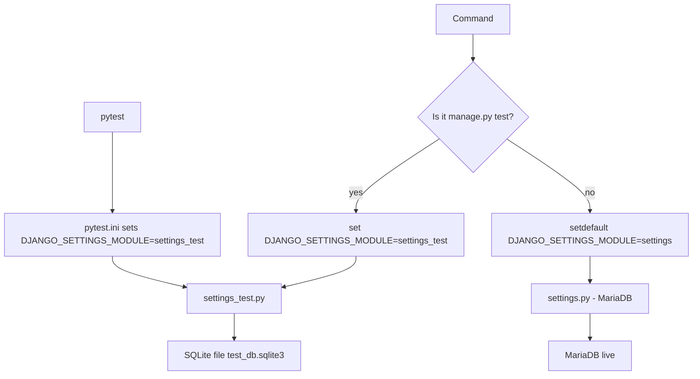

# Plan: Fix Test/Live DB Isolation & Consolidate Standalone Test Runners

> **Implementation status:** The database-isolation goal is implemented, but the original persistent `test_db.sqlite3` design below is not the current implementation. `settings_test.py` redirects SQLite, media, and cache into a unique temporary directory per process, and `manage.py test` plus pytest select these test settings. The temporary directory is cleaned up at process exit. Do not follow the fixed-file examples below as current setup instructions. The test-runner cleanup and AJAX consolidation items have also been applied; this plan is retained as historical design detail.

Combines P0 task 1 (DB isolation) and P1 task 3 (standalone runner cleanup).
Goal: tests must never write to the live MariaDB/MySQL database, and all test
files must be plain discoverable tests with no `if __name__ == "__main__"` blocks.

---

## Part A — Database isolation (P0)

### A1. Create `ebook_manager/settings_test.py`

```python
"""Test settings for ebook_manager.

Uses a dedicated file-based SQLite database so tests never touch the live
MariaDB/MySQL database, even when run outside pytest's environment.
"""

from .settings import *  # noqa: F401,F403

TESTING = True

DATABASES = {
    "default": {
        "ENGINE": "django.db.backends.sqlite3",
        "NAME": BASE_DIR / "test_db.sqlite3",
    }
}
```

`BASE_DIR` and `TESTING` are already defined in `settings.py`; the `*` import
brings them in, then `TESTING` and `DATABASES` are overridden.

### A2. Update `pytest.ini`

Change line 3 from:

```ini
DJANGO_SETTINGS_MODULE = ebook_manager.settings
```

to:

```ini
DJANGO_SETTINGS_MODULE = ebook_manager.settings_test
```

### A3. Update `manage.py`

Replace the `setdefault` line in `main()` with a conditional:

```python
def main():
    """Run administrative tasks."""
    if len(sys.argv) > 1 and sys.argv[1] == "test":
        os.environ["DJANGO_SETTINGS_MODULE"] = "ebook_manager.settings_test"
    else:
        os.environ.setdefault("DJANGO_SETTINGS_MODULE", "ebook_manager.settings")
    try:
        from django.core.management import execute_from_command_line
    except ImportError as exc:
        raise ImportError(
            "Couldn't import Django. Are you sure it's installed and "
            "available on your PYTHONPATH environment variable? Did you "
            "forget to activate a virtual environment?"
        ) from exc
    execute_from_command_line(sys.argv)
```

### A4. Remove fragile override in `settings.py`

Delete the block (lines ~138-145):

```python
# Keep SQLite as backup for testing
if "test" in sys.argv or "pytest" in sys.modules:
    DATABASES = {
        "default": {
            "ENGINE": "django.db.backends.sqlite3",
            "NAME": ":memory:",
        }
    }
```

### A5. Add `test_db.sqlite3` to `.gitignore`

Add under the Django section (near the existing `db.sqlite3` entry):

```gitignore
test_db.sqlite3
```

### Settings resolution flow



---

## Part B — Standalone runner cleanup (P1)

### B1. Remove hardcoded settings bootstrap (the real leak vector)

These files call `django.setup()` and/or
`os.environ.setdefault("DJANGO_SETTINGS_MODULE", "ebook_manager.settings")` at
module level. Remove those lines; Django is already configured by pytest /
`manage.py test` before test modules are imported.

| File                                             | Remove                                            |
| ------------------------------------------------ | ------------------------------------------------- |
| `books/tests/test_models_comprehensive.py`       | lines 42-44 (setdefault + `django.setup()`)       |
| `books/tests/test_mixins_comprehensive.py`       | lines 20-22                                       |
| `books/tests/test_forms_comprehensive.py`        | lines 31-33                                       |
| `books/tests/test_templatetags_comprehensive.py` | lines 20-22                                       |
| `books/tests/test_ajax_scan.py`                  | lines 12-14 (file will be deleted anyway, see B4) |
| `books/tests/test_ebooks_ajax.py`                | lines 13-15 (file deleted, see B4)                |
| `books/tests/test_enhanced_api.py`               | lines 19-21 (file deleted, see B4)                |
| `books/tests/test_real_scan_progress.py`         | lines 17-19                                       |
| `books/tests/test_wizard_context_advanced.py`    | lines 15-16 (setdefault only)                     |

Also clean up now-unused `import django` / `import os` / `import sys` in those
files where the removal leaves them orphaned.

### B2. Remove trivial runner blocks (keep TestCase classes)

Delete only the `if __name__ == "__main__"` block (usually `unittest.main()`):

- `books/tests/test_ai_working.py` (lines 92-93)
- `books/tests/test_ai_filename_recognition.py` (lines 612-613)
- `books/tests/test_forms_comprehensive.py` (lines 592-594)
- `books/tests/test_mixins_comprehensive.py` (lines 870-873)
- `books/tests/test_models_comprehensive.py` (lines 892-895)
- `books/tests/test_templatetags_comprehensive.py` (lines 611-614)

### B3. Remove custom runner functions (keep TestCase classes)

- `books/tests/test_renaming_basic.py`: delete `run_basic_renaming_tests()`
  (lines 404-420) and the `if __name__ == "__main__"` block (lines 423-424).
  The five `TestCase` classes (`BasicRenamingEngineTests`,
  `BasicRenamingViewsTests`, `BasicBatchOperationsTests`,
  `BasicIntegrationTests`, `PredefinedPatternsTests`) stay.
- `books/tests/test_renaming_comprehensive.py`: delete
  `run_comprehensive_tests()` (lines 650-667) and the block (lines 670-672).
  `TC1to9ComprehensiveTests` and `RegressionTests` stay.

### B4. Delete non-test files / legacy scripts

- `books/tests/test_renaming_config.py`: contains only config (`TEST_CONFIG`),
  a utility class (`RenamingTestUtils`), and runner functions — zero
  `TestCase` classes and no external consumers. Delete the file.
- `books/tests/test_ajax_scan.py`: print-based debug script, no assertions.
  Delete.
- `books/tests/test_ebooks_ajax.py`: print-based debug script, no assertions.
  Delete (superseded by `test_ajax_comprehensive.py` `EbooksAjaxTests`).
- `books/tests/test_enhanced_api.py`: `@pytest.mark.skip` legacy script.
  Delete.

---

## Part C — AJAX suite consolidation

### C1. Create canonical `books/tests/test_ajax.py`

Merge `test_ajax_comprehensive.py` and `test_ajax_endpoints.py` into one file:

- Keep one `BaseAjaxTestCaseWithTempDir` base class (they are identical today).
- Keep all test classes; resolve the duplicate `test_ajax_endpoints_csrf_protection`
  name (they test different endpoints, so rename one to disambiguate).
- Preserve imports, `setUp` fixtures, and `@patch` decorators.

Then delete `test_ajax_comprehensive.py` and `test_ajax_endpoints.py`.

Expected result: one canonical AJAX suite covering ebooks/series/comics/
audiobooks list-detail-download, metadata rescan, ISBN lookup, AI feedback,
and theme endpoints, with no duplicate class or method names.

---

## Part D — Verification

1. `python manage.py test books.tests.test_models_comprehensive` runs and
   creates `ebook_manager/test_db.sqlite3` (not in-memory, not MariaDB).
2. `pytest books/tests -q` collects and runs without import errors.
3. `python manage.py test books.tests -q` collects the same tests.
4. Confirm `if __name__ == "__main__"` no longer appears in `books/tests/`:

    ```powershell
    findstr /S /M "__main__" books\tests\*.py
    ```

5. Confirm no new rows in MariaDB after running the suite (spot-check `books_book`
   or equivalent count before/after).
6. Confirm `test_db.sqlite3` is gitignored (`git status` does not show it).
